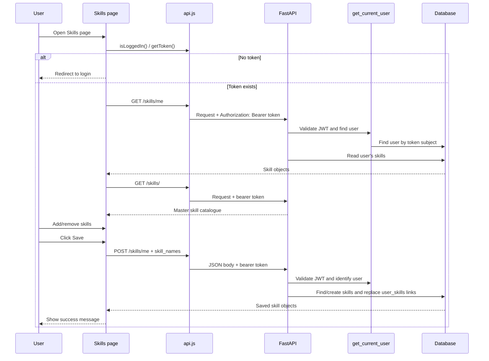

# Day 4 — Skills API Integration

This document records how the Skills page in JobCocoon connects to the existing FastAPI backend.

## Goal

Allow a signed-in user to:

- Load the skills already linked to their account.
- Browse the shared skills catalogue.
- Add existing skills or type a new skill.
- Remove skills locally before saving.
- Save the complete updated skills list to the backend.
- Use the saved skills for job-match calculations.

## Existing implementation

The integration is already present in these files:

| File | Responsibility |
|---|---|
| `frontend/pages/skills.html` | Skills page markup and script loading |
| `frontend/js/skills.js` | Page state, autocomplete, validation, rendering and save action |
| `frontend/js/api.js` | API base URL, token storage and authenticated fetch helper |
| `backend/app/routes/skill.py` | Skills API endpoints |
| `backend/app/models/skill.py` | Skill model and many-to-many association tables |
| `backend/app/models/user.py` | User model and relationship to skills |
| `backend/app/schemas/skill.py` | Request and response validation |
| `backend/app/routes/auth.py` | Current-user authentication dependency |

The page loads `../js/api.js` before `../js/skills.js`, so the API helper functions are available when the Skills page runs.

## Components and responsibilities

### 1. Frontend API helper — `frontend/js/api.js`

The helper exposes:

- `getToken()`: reads `jobcocoon_token` from browser local storage.
- `saveToken(token)`: stores the access token after login.
- `removeToken()`: removes the token on logout or an HTTP 401 response.
- `apiCall(endpoint, method, body)`: sends JSON requests and adds the bearer token when one exists.

Relevant request-header logic:

```js
const headers = { 'Content-Type': 'application/json' };
const token = getToken();

if (token) {
    headers['Authorization'] = `Bearer ${token}`;
}
```

### 2. Skills page — `frontend/js/skills.js`

The page keeps a local working list in `mySkills`. It also loads the master catalogue into `masterSkills` for autocomplete.

On page load it:

1. Checks whether a token exists with `isLoggedIn()`.
2. Redirects to the login page if no token is stored.
3. Loads the current user's profile through `GET /auth/me`.
4. Loads the user's skills through `GET /skills/me`.
5. Loads the shared catalogue through `GET /skills/`.
6. Renders the skill chips, suggestions, count and progress indicator.

The catalogue request is currently optional in the frontend: its error is caught and converted to an empty list.

### 3. Backend skills router — `backend/app/routes/skill.py`

The router is mounted with the `/skills` prefix. All four current routes use `Depends(get_current_user)`, so they require a valid bearer token.

| Method | Endpoint | Purpose |
|---|---|---|
| GET | `/skills/` | Return the shared skills catalogue |
| POST | `/skills/` | Create a catalogue skill if it does not already exist |
| GET | `/skills/me` | Return the signed-in user's skills |
| POST | `/skills/me` | Replace the signed-in user's skills |

The POST `/skills/me` request body is:

```json
{
  "skill_names": ["Python", "SQL", "FastAPI"]
}
```

The response is a list of skill objects containing `id`, `name` and `category`.

### 4. Database relationship

`backend/app/models/skill.py` defines two many-to-many association tables:

- `user_skills`: connects users to their skills.
- `job_skills`: connects jobs to their required skills.

The `User.skills` relationship uses `user_skills`. When a user saves a list, the backend finds each skill by name or creates it, assigns the resulting list to `current_user.skills`, and commits the transaction.

## Request flow



## Authentication and credential handling

Skills API access depends on the existing authentication implementation:

1. Registration sends name, email and password as JSON to `POST /auth/register`.
2. The backend validates the password and stores a bcrypt hash in `users.password_hash`; it does not store the submitted password as plain text.
3. When email verification is enabled, a separate random verification token is generated, stored with a 24-hour expiry, and marked used after successful verification. This email token is not the API access token.
4. Login sends form-encoded fields to `POST /auth/login`. The email is sent in the OAuth2 form field named `username`.
5. The backend verifies the password against the bcrypt hash and checks `is_verified`.
6. A successful login returns a JWT access token. Its subject (`sub`) is the user's email, its signing algorithm is HS256, and its configured lifetime is seven days.
7. The signing secret is read from the backend environment variable `SECRET_KEY`. The application raises an error if it is missing.
8. The frontend stores the access token in local storage under `jobcocoon_token` and sends it as `Authorization: Bearer <token>` on API calls.
9. The backend decodes and verifies the JWT, reads the subject, and looks up the matching user. The skills router uses that user rather than accepting a user ID from the browser.
10. The generic API helper removes the stored token when it receives HTTP 401. Logout also removes it.

Important distinction: `isLoggedIn()` only checks whether a token string exists in local storage. It does not prove that the token is valid; the backend confirms validity when a protected request is made.

## Save behaviour and validation

The frontend:

- Accepts comma-, semicolon- or newline-separated skill names.
- Trims extra whitespace and avoids case-insensitive duplicates.
- Limits a user to 50 skills and each name to 40 characters.
- Shows a warning when there are unsaved changes.
- Sends the entire current list only when the user clicks Save.
- Updates its saved snapshot only after the API call succeeds.

The backend's `UserSkillsUpdate` schema expects a list of strings named `skill_names`. The route replaces the user's existing skill links with the submitted list. An empty list therefore clears the user's skills.

## Manual verification checklist

Run the backend and open the frontend through Live Server. Confirm the frontend's `API_URL` points to the backend you are testing.

- [ ] Logged-out visitor is redirected away from the Skills page.
- [ ] Logged-in user sees their saved skills after refreshing the page.
- [ ] Master catalogue suggestions appear when the catalogue request succeeds.
- [ ] A new skill can be typed and added.
- [ ] Duplicate skill names with different letter casing are not added twice.
- [ ] Removing a chip changes the local list but does not save immediately.
- [ ] Save sends `POST /skills/me` with `{ "skill_names": [...] }`.
- [ ] A successful save survives a page refresh.
- [ ] Saving an empty list clears the user's skills.
- [ ] An invalid/expired token produces HTTP 401, clears the local token and returns the user to login.
- [ ] A request without a bearer token cannot read or change user skills.

## Notes and follow-up improvements

These are observations from the current repository, not claims that the work has already been completed:

1. **Local storage risk:** the JWT is stored in local storage, which JavaScript can read. An XSS vulnerability could expose it. A stronger production design would consider secure, HttpOnly, SameSite cookies and CSRF protections.
2. **Token lifetime:** access tokens last seven days and there is no refresh-token flow in the inspected implementation. Expiry is enforced when the backend decodes the JWT.
3. **Master catalogue access:** `GET /skills/` is currently protected by authentication, matching the router's dependency.
4. **Error visibility:** `skills.js` silently falls back to an empty catalogue if `GET /skills/` fails. A visible warning could make catalogue failures easier to diagnose.
5. **Documentation drift:** the README's roadmap still describes the Skills/profile page as in progress, while `frontend/pages/skills.html` and `frontend/js/skills.js` already exist. The README project structure also does not yet list those two files.

## Day 4 completion criteria

Day 4 is complete when the Skills page can load the authenticated user's skills, retrieve suggestions, save additions/removals through the real API, and retain the saved result after refresh. The checklist above is the acceptance test; mark items complete only after running them against the backend.
