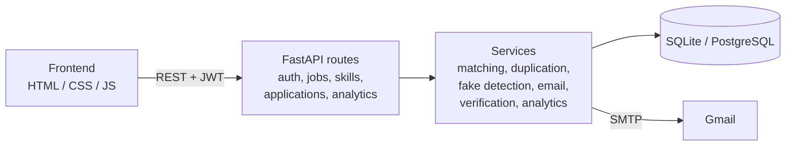
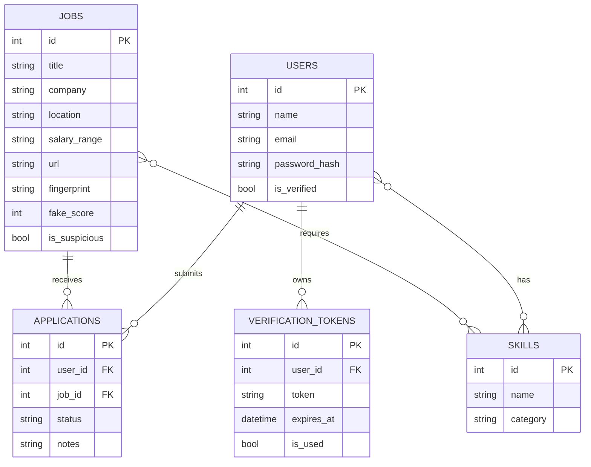

<div align="center">


# JobCocoon

**A job intelligence platform: skill-based job matching, duplicate merging, fake-job detection and an application tracker.**

[](https://www.python.org/)
[](https://fastapi.tiangolo.com/)
[](https://www.sqlalchemy.org/)
[](https://jwt.io/)
[](https://www.chartjs.org/)

[Live Demo](https://job-cocoon-platform.vercel.app/) ·
[API Docs (Swagger)](https://job-intelligence-platform-production-af45.up.railway.app/docs) ·
[Report a Bug](https://github.com/laiba-saghir/job-intelligence-platform/issues) ·
[Request a Feature](https://github.com/laiba-saghir/job-intelligence-platform/issues)

</div>

---

## Table of Contents

- [Overview](#overview)
- [Features](#features)
- [Tech Stack](#tech-stack)
- [Architecture](#architecture)
- [Project Structure](#project-structure)
- [Getting Started](#getting-started)
- [Environment Variables](#environment-variables)
- [Importing Jobs](#importing-jobs)
- [API Reference](#api-reference)
- [How It Works](#how-it-works)
- [Database Schema](#database-schema)
- [Roadmap](#roadmap)
- [Contributing](#contributing)
- [Author](#author)

---

## Overview

Job hunting means checking many sites, seeing the same posting again and again, and wondering which ones are real and which ones fit you.

**JobCocoon** puts that in one place. You add your skills, and the platform ranks jobs by how well they match you. It merges duplicate postings, flags suspicious ones, and tracks every application from "applied" to "offer".

---

## Features

**Accounts**
- Register and login with JWT authentication and bcrypt password hashing
- Email verification through a Gmail SMTP token link (24-hour expiry, resend supported)
- Verification can be switched off for local development with one environment variable

**Jobs**
- Create, search, update and delete jobs, with pagination
- Duplicate detection: MD5 fingerprint for exact matches plus fuzzy matching for near matches
- Fake-job detection: rule-based scoring on keywords, description quality, salary, company and URL
- Community reporting for suspicious postings

**Matching**
- Add your skills and every job gets a match score from 0 to 100
- See which skills you already have and which ones are missing
- Jobs are ranked from best to worst match

**Applications**
- Apply to a job and move it through `applied`, `interview`, `offer`, `accepted` or `rejected`
- Add personal notes and view your application stats

**Analytics**
- Dashboard with metric cards, hiring-demand trend chart and most-demanded skills
- Application analytics (interview rate, success rate)

---

## Tech Stack

| Layer | Technology |
|---|---|
| **Backend** | Python, FastAPI, SQLAlchemy 2.0, Pydantic |
| **Auth** | JWT (python-jose), bcrypt (passlib) |
| **Database** | SQLite for development, PostgreSQL via `DATABASE_URL` for production |
| **Email** | Gmail SMTP |
| **Frontend** | HTML5, CSS3, vanilla JavaScript |
| **Charts and icons** | Chart.js, Font Awesome, Google Fonts (Inter, Playfair Display) |
| **Data** | pandas (CSV importer) |
| **Deployment** | Railway (backend, `Procfile` included) |

---

## Architecture



---

## Project Structure

```text
job-intelligence-platform/
├── backend/
│   ├── app/
│   │   ├── main.py                  # FastAPI app, CORS, router setup
│   │   ├── database/connection.py   # Engine and session (DATABASE_URL)
│   │   ├── models/                  # User, Job, Skill, Application, VerificationToken
│   │   ├── schemas/                 # Pydantic request/response models
│   │   ├── routes/                  # auth, job, skill, application, analytics
│   │   ├── services/                # matching, duplication, fake_detection,
│   │   │                            # analytics, email, verification
│   │   └── utils/auth.py            # JWT and password helpers
│   ├── scripts/import_kaggle_jobs.py
│   ├── data/                        # CSV dataset
│   ├── Procfile                     # Railway start command
│   └── requirements.txt
├── frontend/
│   ├── index.html                   # Login / Register
│   ├── pages/                       # dashboard, jobs, applications,
│   │                                # analytics, verify-email
│   ├── css/                         # style, dashboard, jobs, applications, analytics
│   ├── js/                          # api, auth, dashboard, jobs, applications, analytics
│   └── assets/                      # logo
└── README.md
```

---

## Getting Started

### Prerequisites

- Python 3.11 or newer
- Git
- VS Code with the **Live Server** extension (to serve the frontend)
- A Gmail account with an App Password (only if you want email verification)

### 1. Clone the repository

```bash
git clone https://github.com/laiba-saghir/job-intelligence-platform.git
cd job-intelligence-platform
```

### 2. Create a virtual environment

```bash
python -m venv venv
```

Windows:

```bash
venv\Scripts\activate
```

macOS / Linux:

```bash
source venv/bin/activate
```

### 3. Install dependencies

```bash
pip install -r backend/requirements.txt
```

### 4. Configure environment variables

Create a file named `.env` inside the `backend/` folder. See [Environment Variables](#environment-variables).
For a quick local start without email, this is enough:

```env
REQUIRE_EMAIL_VERIFICATION=false
```

### 5. Run the backend

```bash
cd backend
uvicorn app.main:app --reload
```

Tables are created automatically on startup.

- API: http://127.0.0.1:8000
- Swagger docs: http://127.0.0.1:8000/docs
- Health check: http://127.0.0.1:8000/health

### 6. Point the frontend to your local API

Open `frontend/js/api.js` and set the API address for local development:

```js
const API_URL = 'http://127.0.0.1:8000';
```

### 7. Run the frontend

Open `frontend/index.html` with **Live Server**:

http://127.0.0.1:5500/frontend/index.html

The backend allows `http://127.0.0.1:5500` and `http://localhost:5500` by default.

---

## Environment Variables

| Variable | Default | Purpose |
|---|---|---|
| `DATABASE_URL` | `sqlite:///./job_intelligence.db` | Database connection. Set to a PostgreSQL URL in production. |
| `CORS_ORIGINS` | `http://127.0.0.1:5500,http://localhost:5500` | Comma-separated list of allowed frontend origins. |
| `REQUIRE_EMAIL_VERIFICATION` | `true` | Set to `false` to skip email verification (development only). |
| `FRONTEND_URL` | `http://127.0.0.1:5500/frontend` | Base URL used in the verification link inside emails. |
| `SMTP_EMAIL` | none | Gmail address that sends verification emails. |
| `SMTP_PASSWORD` | none | Gmail **App Password** (not your normal password). |
| `SMTP_SERVER` | `smtp.gmail.com` | SMTP host. |
| `SMTP_PORT` | `587` | SMTP port. |

<details>
<summary>How to create a Gmail App Password</summary>

1. Open your [Google Account](https://myaccount.google.com/) and turn on **2-Step Verification** under Security.
2. Search for **App passwords**.
3. Create one for **Mail** and copy the 16-character password into `SMTP_PASSWORD`.

</details>

For the deployed version, set `CORS_ORIGINS` to `https://job-cocoon-platform.vercel.app` and `FRONTEND_URL` to `https://job-cocoon-platform.vercel.app` on the backend host.

Never commit your `.env` file. It is already listed in `.gitignore`.

---

## Importing Jobs

A script loads jobs from a CSV file into the database. Duplicates are merged automatically, and the first 10 skills of each job are saved.

```bash
cd backend
pip install pandas
python scripts/import_kaggle_jobs.py
```

By default it reads `data/Global_AI_and_Tech_Jobs_Dataset_2026.csv` and imports up to 1000 rows. Change `LIMIT` at the bottom of the script to import more. Rows without a company name are skipped.

---

## API Reference

Interactive documentation is available at `/docs` (Swagger UI). Every route except register, verify, resend and login needs a `Bearer` token.

### Authentication

| Method | Endpoint | Description |
|---|---|---|
| `POST` | `/auth/register` | Register and send a verification email |
| `GET` | `/auth/verify?token=` | Verify email with a token |
| `POST` | `/auth/resend-verification` | Resend the verification email |
| `POST` | `/auth/login` | Login and receive a JWT |
| `GET` | `/auth/me` | Get the current user |

### Jobs

| Method | Endpoint | Description |
|---|---|---|
| `POST` | `/jobs/` | Create a job (with duplicate merge and fake detection) |
| `GET` | `/jobs/` | List jobs (`search`, `skip`, `limit`) |
| `GET` | `/jobs/{id}` | Get one job |
| `PUT` | `/jobs/{id}` | Update a job |
| `DELETE` | `/jobs/{id}` | Delete a job |
| `POST` | `/jobs/{id}/skills` | Attach skills to a job |
| `POST` | `/jobs/{id}/report` | Report a suspicious job |
| `GET` | `/jobs/suspicious/list` | List jobs flagged as suspicious |
| `GET` | `/jobs/matched/for-me` | Jobs ranked by your match score |

### Skills

| Method | Endpoint | Description |
|---|---|---|
| `GET` | `/skills/` | List all skills |
| `POST` | `/skills/` | Create a skill |
| `GET` | `/skills/me` | Get your skills |
| `POST` | `/skills/me` | Replace your skills |

### Applications

| Method | Endpoint | Description |
|---|---|---|
| `POST` | `/applications/` | Apply to a job |
| `GET` | `/applications/` | List your applications |
| `GET` | `/applications/{id}` | Get one application |
| `PUT` | `/applications/{id}` | Update status or notes |
| `DELETE` | `/applications/{id}` | Delete an application |
| `GET` | `/applications/stats/me` | Your application stats |

### Analytics

| Method | Endpoint | Description |
|---|---|---|
| `GET` | `/analytics/overview` | Platform overview |
| `GET` | `/analytics/applications` | Application analytics |
| `GET` | `/analytics/skills` | Skill demand |
| `GET` | `/analytics/trends` | Job posting trends |
| `GET` | `/analytics/dashboard` | All dashboard data in one call |

---

## How It Works

### Matching engine

Skills are compared as sets, so each lookup is O(1) on average.

```python
user_set = {"python", "sql", "git"}
job_set  = {"python", "sql", "docker", "git"}

matched = user_set & job_set     # {"python", "sql", "git"}
missing = job_set - user_set     # {"docker"}
score   = len(matched) / len(job_set) * 100   # 75.0
```

Jobs are then sorted by score, highest first. A job with no listed skills gets a score of 0.

### Duplicate detection

1. **Exact check:** an MD5 fingerprint of the normalized title, company and location.
2. **Fuzzy check:** if there is no exact match, the title and company are compared with `difflib.SequenceMatcher` against the 500 most recent jobs. Both must reach a similarity of 0.85.

A duplicate is merged into the existing job instead of creating a new row.

### Fake-job detection

Each job gets a score from rule-based checks: suspicious keywords (high, medium and low risk), thin descriptions, unrealistic salaries, unknown companies and shortened or messaging links. A score of **50 or more** marks the job as suspicious. Users can also report jobs.

---

## Database Schema



---

## Roadmap

**Done**
- [x] JWT authentication and email verification
- [x] Jobs CRUD with search and pagination
- [x] Skills system and match scoring
- [x] Duplicate merging and fake-job detection
- [x] Application tracker and analytics API
- [x] Frontend: login, email verification, dashboard, jobs, applications, analytics

**In progress**
- [ ] Skills and profile page (manage your skills in the UI)
- [ ] Hide already-applied jobs from the jobs list
- [ ] Server-side search and "load more" on the jobs page
- [ ] Saved jobs stored in the database (currently browser-only)

**Planned**
- [ ] Fresh job data from free public job APIs on a daily schedule (GitHub Actions)
- [ ] OTP-based email verification
- [ ] Resume upload and skill extraction
- [ ] Notifications
- [ ] Production hardening: JWT secret from environment, admin-only job editing, PostgreSQL, database migrations
- [ ] Automated tests

---

## Contributing

Contributions are welcome.

1. Fork the repository
2. Create a branch: `git checkout -b feature/your-feature`
3. Commit your changes: `git commit -m "Add your feature"`
4. Push the branch: `git push origin feature/your-feature`
5. Open a Pull Request

---

## Author

**Laiba Saghir**

[](https://github.com/laiba-saghir)
[](https://www.linkedin.com/in/laiba-saghir-7a7411397/)
[](https://laiba-46lxkm9r4-laibasaghir566-3600.vercel.app/)

---

## Acknowledgments

[FastAPI](https://fastapi.tiangolo.com/) · [SQLAlchemy](https://www.sqlalchemy.org/) · [Chart.js](https://www.chartjs.org/) · [Font Awesome](https://fontawesome.com/) · [Google Fonts](https://fonts.google.com/)

<div align="center">

If this project helped you, consider giving it a star.

</div>